# 🏡 세컨하우스 — AI 챗봇 · 주변 맛집 · 이동경로 파트

> Spring Boot + Flutter + Next.js 기반 **공유 세컨하우스 운영 플랫폼** (팀 프로젝트)
> 이 브랜치(`taeheun`)는 **오태흔**이 맡은 **RAG FAQ 챗봇 · 숙소 주변 맛집 지도 · 이동경로 추적** 기능(**Flutter 앱 + Next.js 웹 + Spring Boot API**)을 중심으로 정리한 문서입니다.

- **기간**: 2026.06.04 \~ 2026.06.29 (약 4주)
- **인원**: 5명 (숙소 · 예약 · 구독 · 배달/결제 · 회원 · 게스트 채팅 등 분담)
- **담당**
  - **Frontend (Flutter)**: 전역 플로팅 챗봇 버튼, 챗봇 대화 화면(근거 FAQ 표시), 숙소 상세 · 주변 맛집 구글 지도, **백그라운드 위치 추적**(포그라운드 서비스), 실시간 이동경로 폴리라인, 숙소 50m 근접 시 버튼 활성화
  - **Frontend (Next.js)**: 전역 플로팅 챗봇 · 채팅창, 숙소 상세 주변 맛집 지도, 내 예약 카드의 **예약 기간별 이동경로 지도**, 네브바 통합
  - **Backend**: Lucene BM25 + Gemini 임베딩 **하이브리드 검색 RAG 챗봇**, 오타 보정 자동완성, Google Places 주변 맛집 수집 · upsert · 주간 스케줄러, 이동경로 세션/좌표 저장 API, 보안 경로 정리 → [🖥 백엔드 섹션](#backend)

---

<a id="screens"></a>

## 🖼 화면

### AI 챗봇

**📱 앱 (Flutter)**

| 전역 플로팅 버튼 (앱) | 챗봇 대화 (앱) |
|:---:|:---:|
| 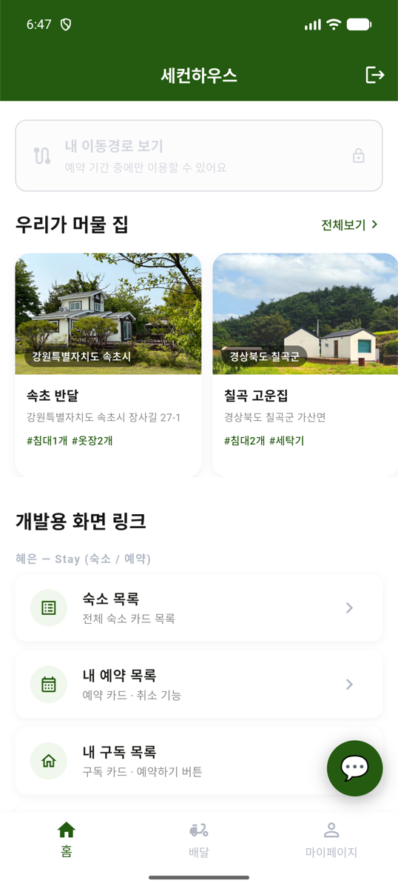 | 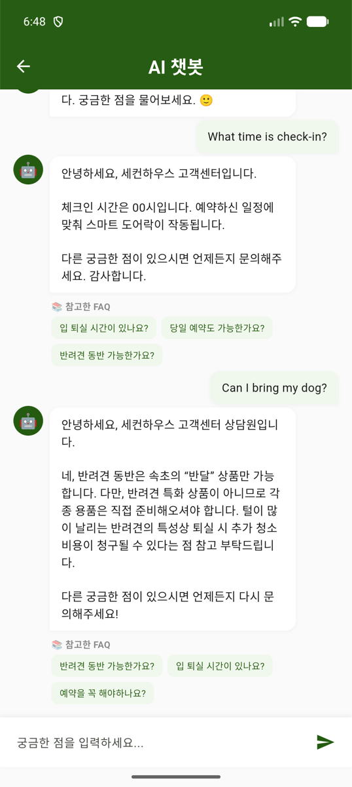 |
| 어느 화면에서든 따라다니는 💬 버튼, **로그인 상태에서만** 노출 | 질문 → RAG 답변 + 답변 근거가 된 **FAQ를 칩으로 표시** |

**💻 웹 (Next.js)**

| 전역 플로팅 버튼 (웹) | 챗봇 채팅창 (웹) |
|:---:|:---:|
| 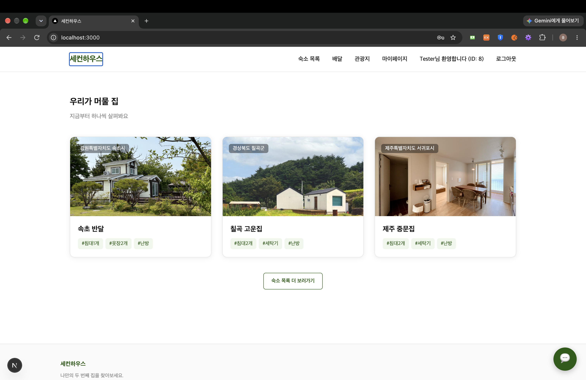 | 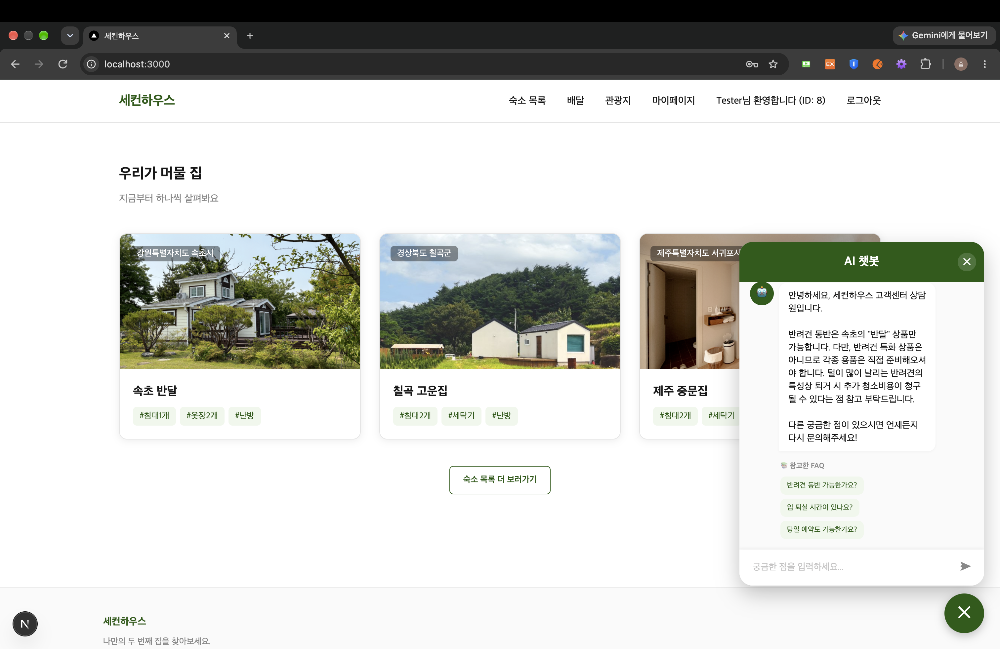 |
| 우측 하단 💬 버튼, 토큰 검증에 성공한 사용자에게만 노출 | 플로팅 패널 채팅창, 페이지를 이동해도 대화 유지 |

> 🔗 API: [`GET /api/chatBot/chat`](#api-spec) — 단어(BM25) + 의미(임베딩) 융합 검색 후 Gemini가 근거 FAQ만으로 답변 생성 ([RAG 흐름](#rag-flow))

### 주변 맛집 지도

| 숙소 상세 · 맛집 지도 (앱) | 숙소 상세 · 맛집 지도 (웹) |
|:---:|:---:|
| 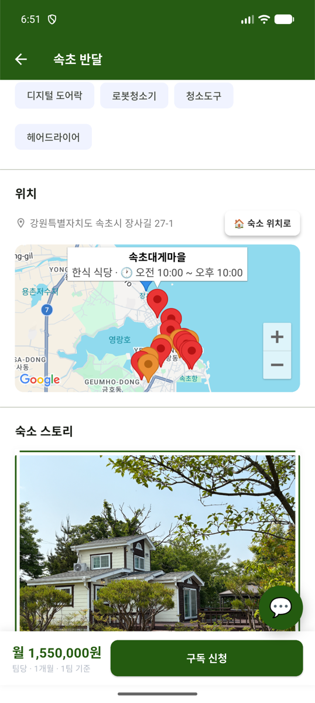 | 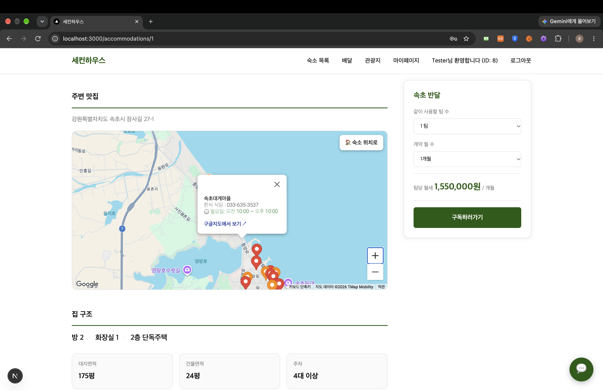 |
| 숙소(파란 마커) 주변 맛집 마커, 탭하면 영업시간 · 전화 · 구글맵 링크 | 상세 페이지의 위치 지도에 주변 맛집 표시 |

> 🔗 API: [`GET /api/places/restaurants`](#api-spec) — 구글을 매번 호출하지 않고 **내 DB에 저장된 맛집**을 인기 상위 10 + 랜덤 5로 응답 ([맛집 수집 흐름](#places-flow))

### 이동경로

| 이동경로 보기 버튼 (앱) | 실시간 추적 (앱) | 예약별 이동경로 (웹) |
|:---:|:---:|:---:|
| 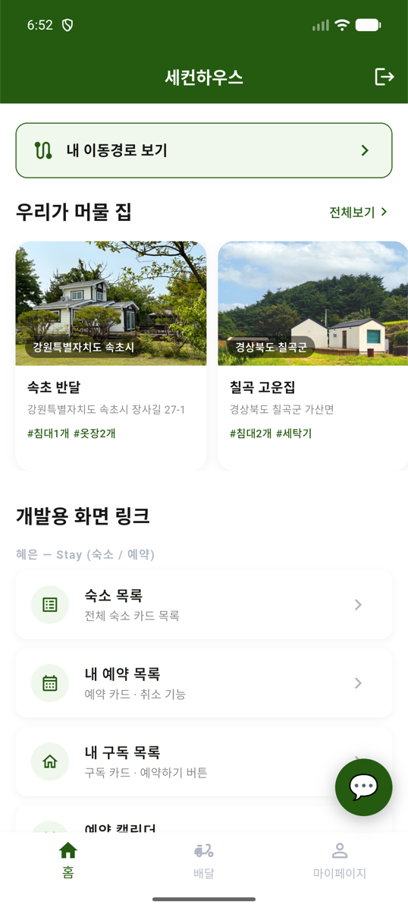 | 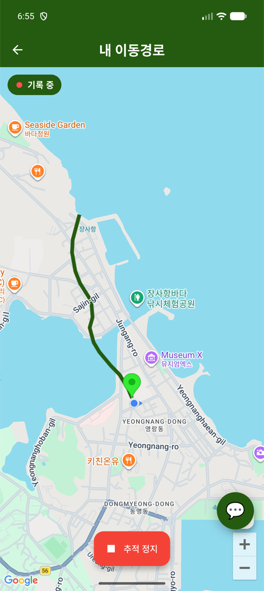 | 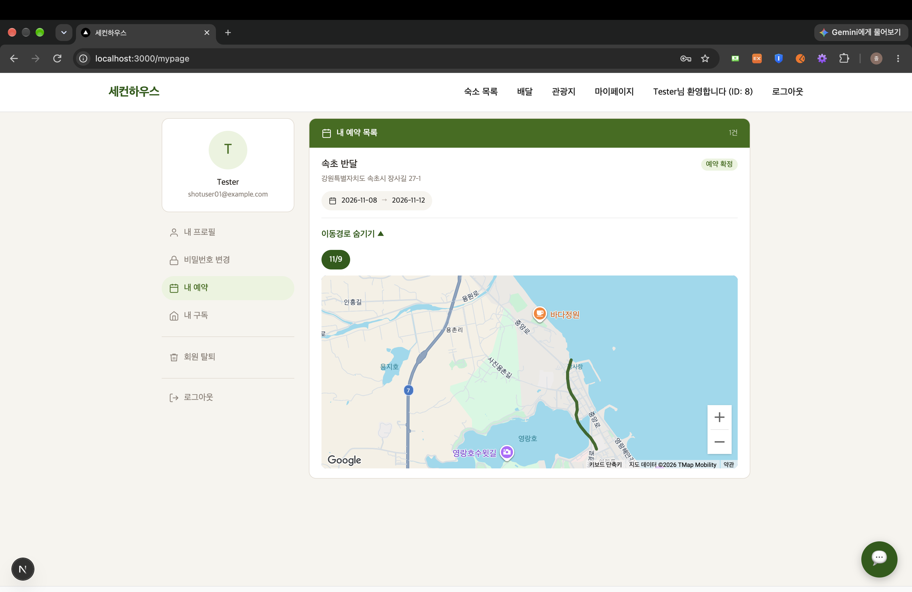 |
| **예약 기간 중 + 숙소 50m 이내**일 때만 버튼 활성화 | 상시 알림 포그라운드 서비스로 **앱을 내려도 위치 기록**, 폴리라인 실시간 갱신 | 내 예약 카드 아래에서 그 **예약 기간의 경로**를 날짜 칩으로 골라 표시 |

> 🔗 API: [`POST /api/routes/sessions`](#api-spec), [`POST /api/routes/sessions/{id}/points`](#api-spec), [`GET /api/routes/sessions/detail`](#api-spec) ([추적 흐름](#route-flow))

---

## 🛠 사용 기술 (Frontend)

| 구분 | 기술 |
|------|------|
| App | Flutter, Dart |
| Web | Next.js 16, React 19, TypeScript, Tailwind CSS 4 |
| 상태 관리 | **Provider** (ChangeNotifier) — 챗봇 대화 / 맛집 / 이동경로 |
| 네트워크 | Dio (토큰 인터셉터), axios / fetch (웹) |
| 지도 | **google_maps_flutter**, **@vis.gl/react-google-maps** |
| 위치 | **geolocator** (위치 스트림), **flutter_foreground_task** (백그라운드 수집) |
| 기타 | flutter_dotenv / `.env`, url_launcher, Git / GitHub |

---

## ✨ 담당 기능 (Frontend)

### 1. 전역 플로팅 챗봇 (Flutter · Next.js 공통)
- Flutter: `MaterialApp.builder`에서 Navigator **바깥**에 버튼을 `Stack`으로 얹어 화면을 이동해도 버튼이 그대로 따라다님
- builder의 context는 Navigator보다 위라 `Navigator.of(context)`를 못 씀 → **`GlobalKey<NavigatorState>`** 로 챗봇 화면 push
- 챗봇 화면이 열려 있는 동안은 `ValueNotifier<bool> isOpen`으로 버튼을 숨겨 화면 위에 겹치지 않게 처리
- 대화 내역은 `ChatBotController`(Provider)가 보관 → 어느 화면에서 열어도 대화가 이어짐, **로그아웃 시 `clear()`** 로 이전 사용자 대화 제거
- Next.js: `layout.tsx`에 `FloatingChatbot`을 두고, 경로가 바뀔 때마다 `/api/users`로 토큰 유효성을 확인 → **블랙리스트 · 만료 토큰이면 버튼 숨김 + 대화 비움**
- 봇 답변에 **근거 FAQ(sources)** 를 함께 표시해 답변 출처를 확인할 수 있게 함

### 2. 주변 맛집 지도
- 숙소 상세 화면에 숙소(파란 마커) + 주변 맛집 마커 표시, 마커 탭 시 업종 · 전화번호 · 요일별 영업시간 · 구글맵 링크(`url_launcher`)
- 웹은 `@vis.gl/react-google-maps`로 동일 기능 구현, **로그인 사용자에게만** 맛집을 불러옴
- API 키는 코드에 넣지 않고 Android `local.properties`(`MAPS_API_KEY`) / 웹 `.env`(`NEXT_PUBLIC_GOOGLE_MAP_KEY`)로 분리, `.example` 파일로 등록 방법 안내

### 3. 백그라운드 이동경로 추적 (Flutter)
- `flutter_foreground_task`로 **상시 알림 포그라운드 서비스**를 띄우고, 별도 **isolate**에서 `geolocator` 위치 스트림을 구독
- `distanceFilter: 50` → **50m 이상 움직였을 때만** 좌표 기록 (GPS 잔떨림 제거)
- 좌표는 ① UI에 실시간 전달(폴리라인 갱신) ② **버퍼에 쌓아 10개마다 / 주기적으로 묶어 전송** (배터리 · 네트워크 절약)

### 4. 숙소 근접 감지 · 버튼 활성화
- 메인 화면에서 내 예약을 불러와 **예약 기간 중인 숙소**만 대상으로 거리 감시
- 숙소 **50m 이내 진입 시 활성화 / 100m 밖으로 나가면 비활성화**
- 버튼을 누르는 시점에 예약 상태를 다시 조회해 **취소된 예약이면 진입 차단**

### 5. 예약 기간별 이동경로 (Next.js)
- 내 예약 카드 아래에서 예약 기간 세션 + 좌표를 한 번에 조회, **기록이 없으면 버튼 자체를 렌더하지 않음**
- 지도는 숙소 중심 · 줌 15로 **한 번만 마운트**하고, 날짜 칩을 바꾸면 **폴리라인만 다시 그림**
- `@vis.gl`에 Polyline 컴포넌트가 없어 `useMap()` + `google.maps.Polyline`으로 직접 그림

### 6. 공통 작업
- Next.js **네브바 통합** 및 메인 화면 버그 수정
- 임시 아이디로 테스트하던 부분 제거 → 전부 JWT 기반 사용자 식별로 변경
- `application-secret.properties.example`, `.env.example`, `local.properties.example`로 **키 등록 방법 문서화**

---

## 🔄 화면 흐름

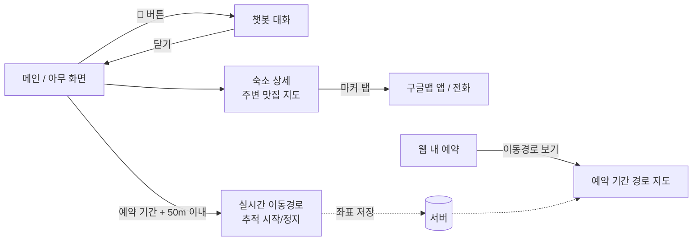

## 🏗 레이어 구조 (Flutter)

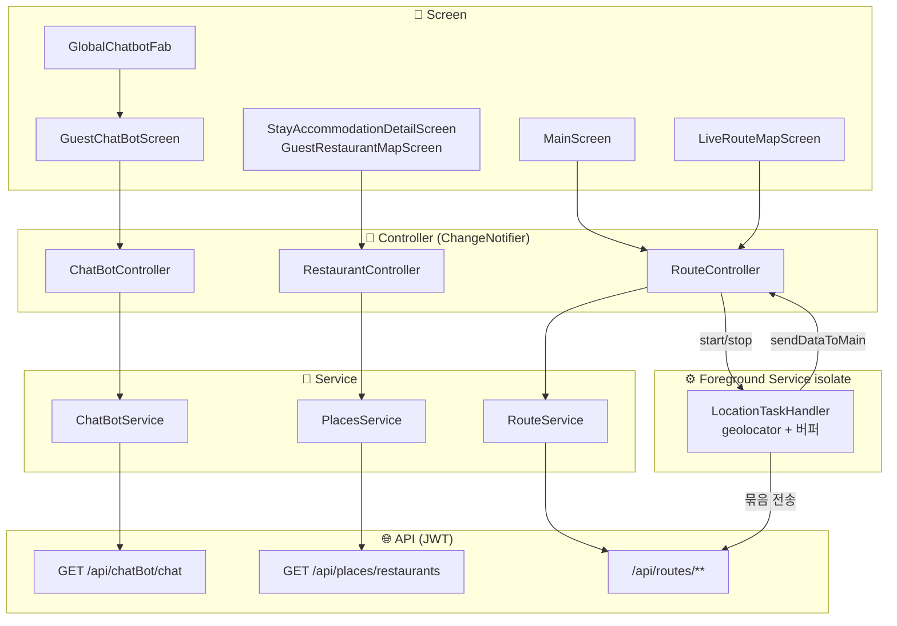

> 🌐 API 계층의 요청 / 응답 형식은 [📡 API 명세](#api-spec) 참고

---

## 🐛 트러블슈팅 (Frontend)

| 문제 | 원인 | 해결 |
|------|------|------|
| 로그아웃 후 다른 계정으로 로그인해도 이전 대화가 남음 | 대화가 Provider 메모리에 유지됨 | 로그아웃 · 인증 실패 시 `clear()` |
| 블랙리스트 처리된 사용자에게도 웹 챗봇 버튼이 보임 | 토큰 존재 여부만으로 로그인 판단 | 경로 변경마다 `/api/users` 호출해 200일 때만 노출 |
| 가만히 있어도 경로가 지그재그로 그려짐 | GPS 잔떨림 좌표까지 전부 기록 | `distanceFilter: 50` |
| 날짜를 바꿀 때마다 웹 지도가 깜빡이고 초기화됨 | 날짜 변경 시 지도 전체를 다시 마운트 | 지도는 한 번만 마운트, Polyline 객체만 교체 |

---

## 📂 담당 주요 파일 (Frontend)

| 구분 | 파일 |
|------|------|
| Flutter Screen | `common/widget/global_chatbot_fab.dart`, `guest_chat_bot_screen.dart`, `guest_restaurant_map_screen.dart`, `live_route_map_screen.dart`, `main_screen.dart`(이동경로 버튼), `stay_accommodation_detail_screen.dart`(맛집 지도) |
| Flutter Controller | `chat_bot_controller.dart`, `restaurant_controller.dart`, `route_controller.dart` |
| Flutter Service | `chat_bot_service.dart`, `places_service.dart`, `route_service.dart`, `service/location_track_handler.dart` |
| Flutter DTO | `chat_bot_answer_dto.dart`, `place_dto.dart`, `route_dto.dart` |
| Next.js | `components/FloatingChatbot.tsx`, `components/ChatWindow.tsx`, `components/Navbar.tsx`, `accommodations/[id]/components/LocationMap.tsx`, `my/reservations/components/ReservationRouteMap.tsx` |
| 설정 | `AndroidManifest.xml`(위치 · 포그라운드 서비스 권한), `local.properties.example`, `.env.example` |

> 📖 RAG 검색기 · 패키지별 역할 상세는 **[Spring_Back/docs/chatbot-rag.md](Spring_Back/docs/chatbot-rag.md)** 참고

---

<a id="backend"></a>

## 🖥 백엔드 (Spring Boot) — 챗봇 · 맛집 · 이동경로 파트

> 앱/웹의 **FAQ 챗봇 · 주변 맛집 · 이동경로** 기능을 담당하는 REST API 서버
> 백엔드 폴더: `Spring_Back` / 상세 문서: `Spring_Back/docs/chatbot-rag.md`

### 🛠 사용 기술 (Backend)

| 구분 | 기술 |
|------|------|
| Backend | Java 17, Spring Boot 3.5 |
| ORM / Query | Spring Data JPA (Hibernate), **QueryDSL 5.0**, JdbcTemplate |
| 검색 | **Apache Lucene 9.12** (BM25, **Nori** 한국어 형태소 분석기, FuzzySuggester) |
| AI | **Google Gemini** — `gemini-embedding-2`(1536차원 임베딩), `gemini-2.5-flash`(답변 생성) |
| 외부 API | **Google Places API (New)** Nearby Search (WebClient) |
| 인증 | Spring Security + **JWT** |
| Database | MariaDB (**VECTOR** 컬럼에 FAQ 임베딩 저장) |
| 기타 | Spring Scheduler, Swagger(SpringDoc), Lombok, Gradle |

### ✨ 담당 기능 (Backend)

#### 1. RAG FAQ 챗봇
- FAQ(질문 · 답변 · 임베딩)를 `sh_faq_docs`에 저장, 임베딩은 MariaDB `VEC_ToText()`로 읽어 `float[]`로 파싱
- **단어 검색**: Lucene **BM25** + Nori(`KoreanAnalyzer`, 복합명사 MIXED 분해) → 질의 토큰을 OR 쿼리로 검색
- **의미 검색**: 질의를 Gemini로 임베딩 → FAQ 벡터와 **코사인 유사도** (단어가 안 겹쳐도 의미가 같으면 검색됨, 예: "강아지" ↔ "반려동물")
- **융합 검색**: 두 점수의 스케일이 달라 **Min-Max 정규화** 후 **BM25 0.3 : 임베딩 0.7 가중합** (RRF도 구현해 비교)
- **생성(G)**: 융합 상위 3개 FAQ만 근거로 프롬프트 구성 → `gemini-2.5-flash`가 답변, **자료에 없으면 모른다고 답하고 고객센터 안내** (환각 방지)
- 응답에 근거 FAQ(`sources`)를 같이 내려 프론트에서 출처 표시

#### 2. 캐싱 · 비용 절감
- 코퍼스 · id 맵 · Lucene 색인은 **첫 요청 때 1회 조립 후 캐시** (`volatile` + double-checked locking)
- 같은 질의의 임베딩은 `ConcurrentHashMap.computeIfAbsent`로 캐시 → Gemini 재호출 방지
- Gemini 실패는 `ChatBotGeminiApiException` → 전용 핸들러에서 공통 에러 JSON으로 변환

<a id="backend-places"></a>

#### 3. 주변 맛집 수집 (Google Places)
- 숙소 좌표 중심 반경 2km를 **Places Nearby Search**로 조회
- 숙소 FK로 `sh_restaurant`에 저장, **(accommodation_id, place_id) 유니크** 기준 **upsert** — 기존 행은 QueryDSL `IN` 한 번으로 조회 후 **변경 감지로 UPDATE**, 신규만 `saveAll`
- 구글 응답 순서를 `popularity_rank`로 저장, 업종 코드(`japanese_restaurant`)는 한글 표시명(`일식`)으로 변환
- 조회 API는 **구글을 호출하지 않고 DB만 사용**: 인기 상위 10개 + 나머지에서 **랜덤 5개** → 매번 조금씩 다른 맛집 노출
- `PlacesSyncScheduler`: **매주 월요일 04:00(KST)** 전체 숙소 동기화, 숙소마다 **독립 트랜잭션**이라 하나가 실패해도 나머지 계속 진행

#### 4. 이동경로 저장 · 조회
- 좌표마다 **기기 측정 시각(`recordedAt`)** 을 저장해 네트워크 지연과 무관하게 순서 보장
- 웹용 `GET /sessions/detail?from=&to=` — 예약 기간에 시작된 세션 + 좌표를 **한 번에** 반환
- 사용자는 요청 파라미터가 아닌 **JWT(`@AuthenticationPrincipal`)에서 식별**

#### 5. 보안 경로 정리
- `/api/chatBot/**`, `/api/places/**`, `/api/routes/**`는 **로그인 필수**

<a id="api-spec"></a>

### 📡 API 명세

| 기능 | Method | URL | 인증 | 사용 화면 |
|------|--------|-----|:---:|------|
| RAG 답변 생성 | GET | `/api/chatBot/chat` | ✅ | 챗봇 (앱 · 웹) |
| 융합 검색 | GET | `/api/chatBot/fusion` | ✅ | (검색 결과 확인용) |
| BM25 / 임베딩 단독 검색 | GET | `/api/chatBot/lucene`, `/api/chatBot/embedding` | ✅ | (비교 · 테스트용) |
| 자동완성 (오타 보정) | GET | `/api/chatBot/suggest` | ✅ | (추천 검색어) |
| FAQ 단건 | GET | `/api/chatBot/faq/{id}` | ✅ | (추천 검색어 클릭) |
| 주변 맛집 동기화 | GET | `/api/places/restaurants/sync` | ✅ | (관리 · 스케줄러) |
| 저장된 맛집 조회 | GET | `/api/places/restaurants` | ✅ | 숙소 상세 지도 |
| 추적 시작 | POST | `/api/routes/sessions` | ✅ | 실시간 이동경로 |
| 좌표 묶음 저장 | POST | `/api/routes/sessions/{id}/points` | ✅ | (백그라운드 서비스) |
| 추적 종료 | POST | `/api/routes/sessions/{id}/end` | ✅ | 실시간 이동경로 |
| 세션 좌표 조회 | GET | `/api/routes/sessions/{id}/points` | ✅ | 실시간 이동경로 |
| 세션 이력 | GET | `/api/routes/sessions` | ✅ | — |
| 기간별 경로 (세션+좌표) | GET | `/api/routes/sessions/detail` | ✅ | 웹 내 예약 |

<details>
<summary>요청 / 응답 예시</summary>

**RAG 답변**
```
GET /api/chatBot/chat?q=반려동물 동반 가능한가요?&topK=3
Authorization: Bearer {accessToken}
```
```json
{
  "query": "반려동물 동반 가능한가요?",
  "answer": "네, 일부 숙소는 반려동물 동반이 가능합니다. ...",
  "sources": [
    { "id": "7", "score": 0.94, "question": "반려동물과 함께 입실할 수 있나요?", "answer": "..." }
  ]
}
```

**저장된 맛집 조회**
```
GET /api/places/restaurants?accommodationId=1
```
```json
[
  {
    "id": "ChIJ...", "accommodationId": 1, "name": "OO식당", "primaryType": "한식",
    "phoneNumber": "051-000-0000", "latitude": 35.15, "longitude": 129.05,
    "googleMapsUri": "https://maps.google.com/?cid=...",
    "weekdayDescriptions": ["월요일: 오전 11:00~오후 9:00", "..."],
    "popularityRank": 0
  }
]
```

**이동경로**
```
POST /api/routes/sessions                 → { "success": true, "sessionId": 3 }
POST /api/routes/sessions/3/points
[ { "lat": 35.1587, "lng": 129.1604, "recordedAt": "2026-06-23T14:02:11" }, ... ]
                                          → { "success": true, "saved": 10 }
POST /api/routes/sessions/3/end           → { "success": true }
GET  /api/routes/sessions/detail?from=2026-06-20&to=2026-06-23
```
```json
[ { "sessionId": 3, "startedAt": "2026-06-23T14:00:00", "endedAt": "2026-06-23T15:10:00",
    "points": [ { "lat": 35.1587, "lng": 129.1604, "recordedAt": "..." } ] } ]
```
> 토큰이 없거나 무효하면 `401` → 앱은 "로그인이 필요해요" 안내
</details>

<a id="rag-flow"></a>

### 🤖 RAG 답변 흐름

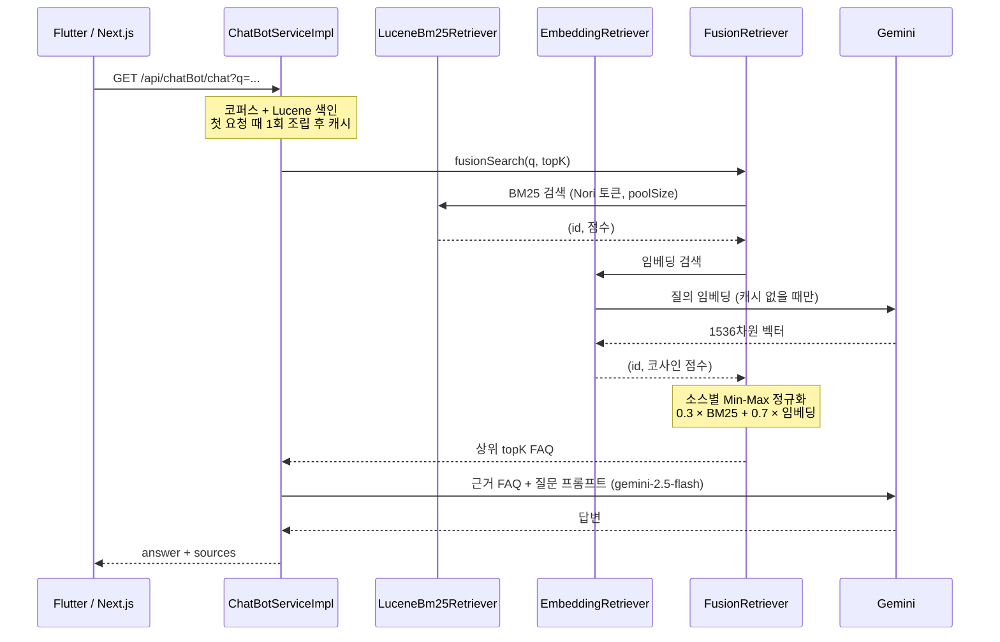

<a id="places-flow"></a>

### 🍜 맛집 수집 · 조회 흐름

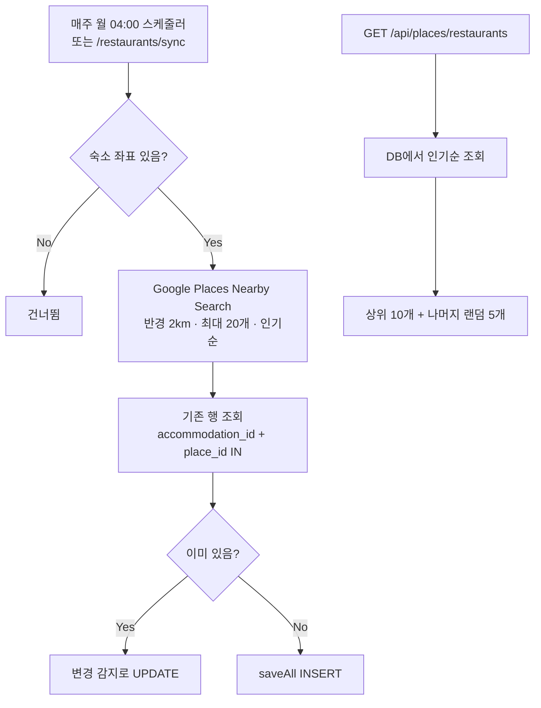

<a id="route-flow"></a>

### 🗺 이동경로 추적 흐름

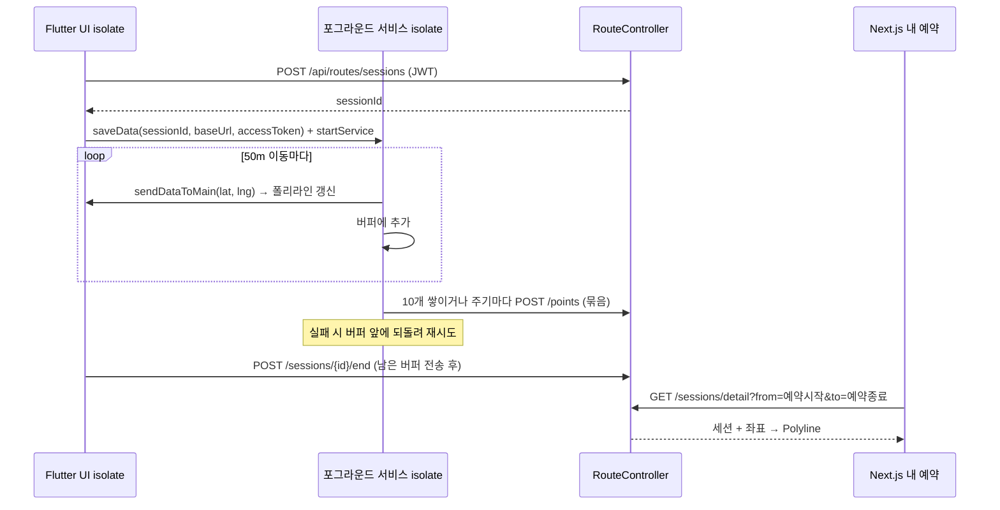

### 🗄 DB 관계 (담당 기능 관련)

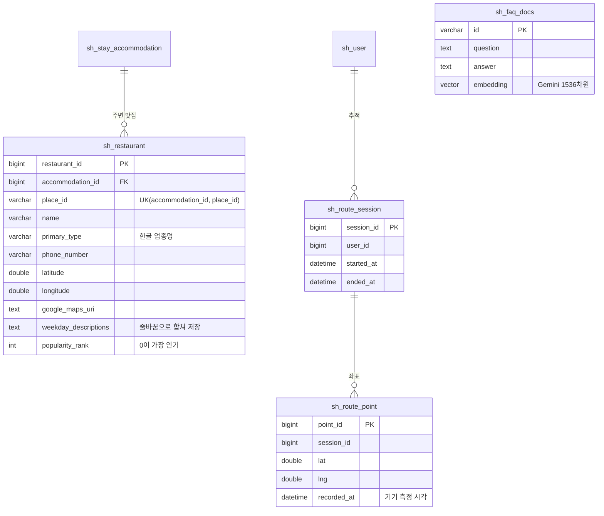

- 같은 맛집이 여러 숙소 근처일 수 있어 맛집 테이블은 **숙소별로 행을 가짐** → 중복 기준은 `(숙소, place_id)`
- FAQ는 JPA 엔티티가 아니라 **JdbcTemplate**으로 조회 (VECTOR 컬럼을 `VEC_ToText()`로 변환해야 하기 때문)

<a id="backend-trouble"></a>

### 🐛 트러블슈팅 (Backend)

| 문제 | 원인 | 해결 |
|------|------|------|
| 융합 검색 결과가 BM25 쪽으로만 쏠림 | BM25 점수(0\~수십)와 코사인(0\~1) 스케일이 다름 | 소스별 **Min-Max 정규화** 후 가중합 |
| "강아지 데려가도 되나요?"가 반려동물 FAQ를 못 찾음 | BM25는 단어가 겹쳐야만 매칭 | **임베딩 의미 검색**을 더해 하이브리드로 변경 |
| FAQ에 없는 질문에도 그럴듯한 답을 지어냄 | LLM이 근거 밖 지식으로 답변 | 프롬프트에 **근거 자료만 사용 · 없으면 모른다고 안내** 명시 |
| 요청마다 FAQ 로드 · 색인 생성으로 느림 | 매 요청 코퍼스를 다시 조립 | **첫 요청 1회 조립 후 캐시** (double-checked locking) |
| 상세 화면 열 때마다 구글 API 비용 발생 | 조회 시마다 Places 호출 | 스케줄러로 DB에 저장, **조회는 DB만** 사용 |

### 📂 담당 주요 파일 (Backend)

| 계층 | 파일 |
|------|------|
| Controller | `ChatBotController`, `PlacesController`, `RouteController` |
| Service | `ChatBotServiceImpl`, `PlacesServiceImpl`, `RouteService` |
| RAG | `LuceneBm25RetrieverForRag`, `EmbeddingRetrieverForRag`, `FusionRetrieverForRag`, `SuggesterForRag`, `GeminiQueryEmbeddingProviderForRag`, `GeminiEmbeddingClientForRag`, `GeminiChatClientForRag` |
| Places | `GooglePlacesClient`, `PlacesSyncScheduler`, `PrimaryTypeConverter` |
| Repository | `ChatBotRepositoryImpl`(JdbcTemplate), `RestaurantRepositoryImpl`(QueryDSL), `RouteSessionRepository`, `RoutePointRepository` |
| Entity / DTO | `Restaurant`, `RouteSession`, `RoutePoint`, `PlaceDTO`, `RoutePointDTO`, `RouteSessionDetailDTO`, `ChatBotFaqDocDTO` |
| 기타 | `GoogleConfig`(WebClient), `ChatBotGeminiExceptionHandler`, `VectorParserForChatBot`, `SecurityConfig` |

---

## 🏛 프로젝트 전체 기능 (팀)

회원가입 · 로그인(구글 · 카카오 소셜) · 숙소 목록/상세 · 숙소 예약 · 숙소 스토리 · 구독 / 대기 구독 · 장바구니 · 주문 · 결제 · 배달 · 알림 · 관광지(공공데이터) · 게스트 채팅(WebSocket) · **AI 챗봇** · **주변 맛집** · **이동경로**

---

## ▶ 실행 방법

### 백엔드

```bash
cd Spring_Back
# 1. MariaDB 준비 후 application.properties의 DB 정보 설정
# 2. application-secret.properties.example → application-secret.properties 복사 후 키 입력
#    gemini.api.key / google.places.api.key / tour.api.service-key
# 3. 실행
./gradlew bootRun
```

### 앱 (Flutter)

```bash
cd flutter_front
# 1. 프로젝트 루트에 .env 생성 (백엔드 서버 주소)
# 2. android/local.properties에 구글맵 키 추가
echo "MAPS_API_KEY=<구글맵 키>" >> android/local.properties
# 3. 패키지 설치 후 실행
flutter pub get
flutter run
```

### 웹 (Next.js)

```bash
cd nextjs_front
# 1. .env.example을 참고해 .env 생성
#    NEXT_PUBLIC_SERVER_URL / NEXT_PUBLIC_WEBSOCKET_URL / NEXT_PUBLIC_GOOGLE_MAP_KEY / NEXT_PUBLIC_GOOGLE_MAP_ID
# 2. 실행
npm install
npm run dev
```
